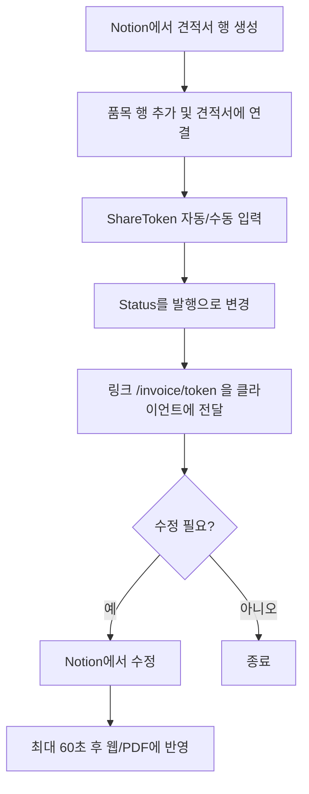
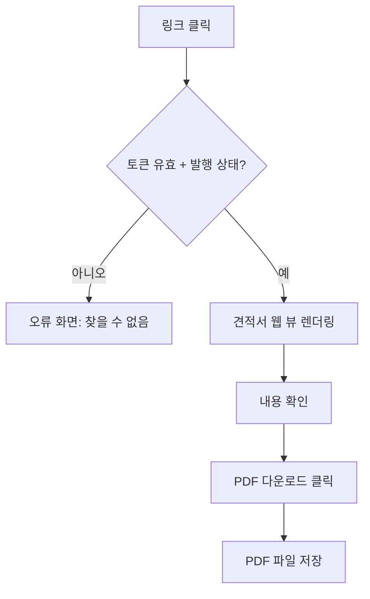

# PRD: Notion 연동 견적서 웹 뷰어 & PDF 다운로드 (MVP)

| 항목 | 내용 |
|------|------|
| 문서 버전 | v0.1 (초안) |
| 작성일 | 2026-11-14 |
| 상태 | 검토 대기 (`[가정]` 및 14장 열린 질문 확정 필요) |
| 대상 규모 | 개발자 1~2명, 2~3주 |

> 표기 규칙: `[가정]`은 아직 확인/확정되지 않은 사항이다. 라이브러리 동작 중 Context7 문서로 확인한 것은 `[확인]`으로 표시한다.

---

## 0. 사전 조사 요약

- 현재 코드베이스는 Next.js 15.5 + React 19.3 + Tailwind v4 스타터킷이며 `app/`, `components/`, `lib/`, `config/`가 루트에 있다(`src/` 없음). 페이지는 홈/소개 수준이고 도메인 코드는 없다.
- 설치된 UI 컴포넌트: `badge`, `button`, `card`, `input`, `separator` (Base UI 기반 base-nova). `table` 등은 **신규 추가** 대상이다.
- `config/site.ts`는 아직 스타터 값("Next.js Starter")이므로 서비스명/네비게이션 갱신이 필요하다.
- **신규 도입 의존성**: `@notionhq/client`, `@react-pdf/renderer`, (선택) `zod`. 테스트 프레임워크 없음.
- Context7 확인 [확인]: `@notionhq/client`의 `pages.retrieve`는 `filter_properties`를 지원하고, 최신 SDK는 `dataSources.query`로 조회하며 `APIErrorCode.RateLimited`로 레이트리밋을 구분한다. `@react-pdf/renderer`는 `Font.register`(Node에서는 절대 경로 또는 URL)와 `renderToBuffer`를 제공해 Route Handler에서 바로 Buffer를 반환할 수 있다.

---

## 1. 개요

### 1.1 배경
프리랜서/소규모 사업자는 견적서를 Notion, 스프레드시트, 워드 등에 흩어 작성하고, 클라이언트에게 PDF를 수동으로 만들어 메일로 보낸다. 수정이 생길 때마다 파일을 다시 만들고 버전이 어긋난다.

### 1.2 문제 정의
- 공급자: 이미 Notion에 정리한 견적 데이터를 다시 문서 도구에 옮겨 적어야 한다.
- 클라이언트: 첨부 파일을 내려받아야 열람 가능하고, 최신본인지 알 수 없다.

### 1.3 비전
"Notion에서 작성하면 링크 하나로 최신 견적서가 열리고, 버튼 한 번으로 PDF가 받아진다."

### 1.4 한 줄 요약
Notion 데이터베이스의 견적서를 고유 링크로 웹에서 열람하고 PDF로 내려받는 읽기 전용 서비스.

---

## 2. 목표와 성공 지표

### 2.1 목표
1. 공급자는 Notion 입력만으로 견적서 페이지를 발행한다(별도 입력 UI 없음).
2. 클라이언트는 로그인 없이 링크만으로 열람하고 PDF를 받는다.
3. 웹과 PDF의 금액·품목 내용이 100% 일치한다.

### 2.2 성공 지표

| 지표 | 목표값 | 측정 방법 |
|------|--------|-----------|
| 견적서 페이지 LCP (캐시 히트) | ≤ 2.0초 (모바일 4G, Lighthouse) | Lighthouse CI/수동 측정 |
| 견적서 페이지 TTFB (캐시 미스, Notion 조회 포함) | ≤ 2.5초 (p95) | 서버 로그 |
| PDF 생성 시간 (품목 20행) | ≤ 5초 (p95) | Route Handler 응답 시간 |
| 링크 열람 → PDF 다운로드 전환율 | ≥ 40% `[가정]` | 서버 로그 기반 집계(MVP 이후 분석 도구 도입 시) |
| 웹/PDF 금액 불일치 | 0건 | 수락 테스트(FR-008) |
| 한글 깨짐(PDF) | 0건 | 수동 검수 체크리스트 |

### 2.3 MVP 완료 기준 (Definition of Done)
- [ ] 실제 Notion DB의 견적서 1건 이상이 고유 링크로 열람된다.
- [ ] 동일 견적서를 PDF로 내려받아 한글/금액이 정상 표시된다.
- [ ] 잘못된 토큰, 미발행 견적서, Notion 장애 시 각각 지정된 오류 화면이 표시된다.
- [ ] `npm run lint`, `npm run build` 통과.
- [ ] Vercel(또는 확정된 플랫폼)에 배포되어 외부 기기(모바일 포함)에서 확인된다.

---

## 3. 사용자 및 페르소나

### 3.1 공급자 — "민지, 1인 웹 디자이너"
- 목표: 견적을 빠르게 보내고, 수정 시 같은 링크로 최신본을 보여주고 싶다.
- 불편: PDF 재생성/재전송, 양식 통일 부담.
- 시나리오: Notion에서 견적서 행과 품목을 입력 → 상태를 "발행"으로 변경 → 생성된 공유 링크를 메신저로 전달.

### 3.2 클라이언트 — "대표 김 사장님(비개발자)"
- 목표: 금액과 범위를 한눈에 확인하고 내부 결재용 PDF를 보관한다.
- 불편: 가입/설치 요구, 첨부 파일 버전 혼선.
- 시나리오: 링크 클릭 → 견적서 확인 → "PDF 다운로드" 클릭 → 파일 보관.

---

## 4. 사용자 여정

### 4.1 공급자 플로우


### 4.2 클라이언트 플로우


---

## 5. 기능 요구사항

우선순위: **P0** = MVP 필수, **P1** = MVP 포함하되 일정 압박 시 제외 가능.

| ID | 우선순위 | 기능 | 설명 | 수락 기준 (Given / When / Then) |
|----|---------|------|------|----------------------------------|
| FR-001 | P0 | Notion 견적서 조회 | 서버에서 토큰으로 견적서 1건과 연결된 품목을 조회 | **Given** Status=발행인 견적서와 품목 3건이 존재 **When** 해당 토큰으로 조회 **Then** 견적서 1건과 품목 3건이 `Invoice` 타입으로 반환된다 |
| FR-002 | P0 | 견적서 웹 뷰어 | `/invoice/[token]`에서 읽기 전용 렌더링 | **Given** 유효한 토큰 **When** 페이지 접속 **Then** 견적번호, 발행일, 유효기간, 공급자/클라이언트 정보, 품목표, 합계가 표시된다 |
| FR-003 | P0 | PDF 다운로드 | `/invoice/[token]/pdf` Route Handler가 PDF 반환 | **Given** 유효한 토큰 **When** 다운로드 버튼 클릭 **Then** `Content-Type: application/pdf`, `Content-Disposition: attachment; filename="견적서-{번호}.pdf"` 응답을 받는다 |
| FR-004 | P0 | 한글 PDF 렌더링 | 번들된 한글 폰트를 등록하여 사용 | **Given** 품목명에 한글/영문/숫자/특수문자(㈜, ₩) 포함 **When** PDF 생성 **Then** 모든 글자가 대체 글꼴(□) 없이 표시된다 |
| FR-005 | P0 | 접근 제어 | 추측 불가능 토큰 + 발행 상태 검증 | **Given** Status≠발행 또는 토큰 불일치 **When** 접속 **Then** 404 화면이 표시되고 견적서 존재 여부가 구분되지 않는다 |
| FR-006 | P0 | 오류/빈 상태 | 404, Notion 오류(5xx/레이트리밋), 품목 0건 처리 | **Given** Notion API가 429/5xx 응답 **When** 페이지 요청 **Then** 재시도 안내가 있는 오류 화면이 표시되고 스택/토큰은 노출되지 않는다. **Given** 품목 0건 **Then** "등록된 품목이 없습니다" 문구가 표시된다 |
| FR-007 | P0 | 금액 계산 | 품목 금액 = 수량×단가, 공급가액/부가세/총액을 앱에서 계산 | **Given** 수량 2, 단가 100,000, 부가세율 10% **When** 렌더링 **Then** 공급가액 200,000 / 부가세 20,000 / 총액 220,000원으로 표시된다 |
| FR-008 | P0 | 웹/PDF 일치 | 동일한 계산 함수와 데이터 소스 사용 | **Given** 동일 견적서 **When** 웹과 PDF의 총액·품목 수를 비교 **Then** 100% 일치한다 |
| FR-009 | P0 | 로딩 상태 | 서버 렌더링 중 스켈레톤 표시 | **Given** 느린 Notion 응답 **When** 페이지 진입 **Then** `loading.tsx` 스켈레톤이 표시된 뒤 본문으로 교체된다 |
| FR-010 | P0 | 반응형 + 다크모드 | 360px~1280px 지원, 기존 `ThemeProvider` 활용 | **Given** 360px 뷰포트 **When** 견적서 열람 **Then** 가로 스크롤 없이 품목이 읽을 수 있게 표시된다 |
| FR-011 | P1 | 인쇄 스타일 | 웹에서 브라우저 인쇄 시 헤더/푸터/버튼 숨김 | **Given** 견적서 페이지 **When** 인쇄 미리보기 **Then** 헤더, 푸터, 다운로드 버튼이 보이지 않는다 |
| FR-012 | P1 | 만료 표시 | 유효기간이 지난 견적서에 "만료" 배지 표시 | **Given** ValidUntil < 오늘 **When** 열람 **Then** "만료" 배지가 표시된다(열람/다운로드는 허용) |
| FR-013 | P1 | 검색엔진 차단 | 견적서 페이지 noindex | **Given** 견적서 페이지 **When** 응답 헤더/메타 확인 **Then** `noindex, nofollow`가 포함된다 |

---

## 6. 비기능 요구사항

### 6.1 성능
- 견적서 페이지: 8장의 지표(2.2) 준수. 품목 최대 50행을 MVP 상한으로 한다 `[가정]`.
- PDF Route Handler: Node 런타임, 응답 ≤ 5초(p95), 메모리 ≤ 512MB `[가정]`.

### 6.2 보안
- Notion Integration Token은 서버 환경변수(`NOTION_TOKEN`)로만 사용하고 클라이언트 번들에 포함하지 않는다(`NEXT_PUBLIC_` 접두사 금지).
- 공유 토큰은 암호학적 난수 기반, 최소 128비트(UUID v4 또는 nanoid 21자 이상). 순차 ID/Notion 페이지 ID를 URL에 쓰지 않는다.
- 토큰 불일치/미발행/삭제를 모두 동일한 404로 응답한다(존재 여부 노출 방지).
- 응답 헤더: `X-Robots-Tag: noindex`, `Referrer-Policy: no-referrer`, `Cache-Control`은 공유 캐시에 의한 유출을 막기 위해 `private` 또는 서버 캐시만 사용 `[가정]`.

### 6.3 접근성
- WCAG 2.1 AA 수준 색 대비, 품목표는 `<table>` 시맨틱(`<th scope>`), 키보드로 다운로드 버튼 접근 가능.

### 6.4 브라우저 지원
- 최신 Chrome, Edge, Safari(iOS 16+), Firefox 최근 2개 버전.

### 6.5 한글 PDF 품질
- Noto Sans KR 또는 Pretendard 정적 폰트(Regular/Bold)를 저장소에 포함(`lib/pdf/fonts/`)하고 `Font.register`에 절대 경로로 등록 [확인: Node에서는 절대 경로 또는 URL 사용]. 서브셋/라이선스(OFL) 확인 필요 `[가정]`.
- 폰트 형식은 TTF 사용 `[가정: woff2 미지원 가능성, 구현 시 검증]`.

### 6.6 캐싱/재검증 전략
- Notion 조회 결과를 서버 캐시(`unstable_cache` 또는 `fetch` revalidate)로 **60초** 캐시, 태그: `invoice:{token}` `[가정]`.
- 수정 반영 지연 최대 60초임을 공급자 가이드에 명시한다.
- Notion 레이트리밋 [확인: Notion 공식 문서]: 연결당 평균 약 3요청/초(Business 이상 플랜은 약 10요청/초), data source 쿼리도 연결당 약 3요청/초. 초과 시 429 + `Retry-After`(최대 60초). 견적서 1건 조회가 쿼리 2회이므로 캐시가 사실상 필수다.
- 캐시와 요청 병합으로 완화한다. `APIErrorCode.RateLimited` 발생 시 마지막 성공 캐시를 우선 제공(stale-while-error)하거나 오류 화면을 표시한다 [확인: SDK가 RateLimited 코드를 제공].
- SDK 자동 재시도 [확인]: 기본 `maxRetries` 2, 초기 지연 1초, 최대 60초. 429/529는 모든 메서드, 500/503은 GET/DELETE만 재시도한다. `dataSources.query`는 POST이므로 500/503은 SDK가 재시도하지 않아 앱 레벨 재시도(최대 1회) 도입 여부를 구현 시 결정한다 `[가정]`.
- 토큰 형식 사전 검증: Notion 호출 전에 토큰이 UUID 형식인지 검사해 잘못된 요청이 Notion 호출·캐시 키 증가로 이어지지 않게 한다.
- 견적서 1건 조회 = 견적서 data source 쿼리 1회 + 품목 data source 쿼리 1회(품목 100건 초과 시 페이지네이션으로 추가)로 제한한다.

---

## 7. 데이터 모델

### 7.1 Notion 데이터베이스 스키마 제안

두 개의 데이터베이스를 사용한다: **Invoices**(견적서), **InvoiceItems**(품목). 품목은 Relation으로 견적서에 연결한다.

- Relation은 **양방향(Dual)** 으로 설정한다(Invoices.`Items` ↔ InvoiceItems.`Invoice`). 앱은 품목 DB의 `Invoice` 필터로 품목을 조회한다(9.4장 근거 참조).
- Notion API 버전 `2025-09-03`부터 스키마는 data source에 속한다. 각 DB는 data source 1개만 두는 것으로 가정하며, 앱은 data source ID로 쿼리한다 [확인].
- 속성명은 코드 상수(`lib/notion/schema.ts`)와 정확히 일치해야 한다. 이름 변경 시 조회가 실패한다.

**Invoices**

| 속성명 | 타입 | 필수 | 예시 |
|--------|------|------|------|
| Number | Title | O | `Q-2026-0042` |
| ShareToken | Text | O | `b7c1e0f2-8a6d-4c1e-9f3a-2d5e7a1c4b90` |
| Status | Select (초안/발행/보관) | O | `발행` |
| IssueDate | Date | O | `2026-11-14` |
| ValidUntil | Date | O | `2026-12-14` |
| ClientName | Text | O | `주식회사 한빛` |
| ClientContact | Text | X | `김한빛 / hanbit@example.com` |
| SupplierName | Text | O | `민지 디자인` |
| SupplierBizNo | Text | X | `123-45-67890` |
| SupplierContact | Text | X | `010-1234-5678` |
| TaxRate | Number (%) | O (기본 10) | `10` |
| Note | Text | X | `계약금 50% 선입금` |
| Items | Relation → InvoiceItems | O | 품목 3건 |

**InvoiceItems**

| 속성명 | 타입 | 필수 | 예시 |
|--------|------|------|------|
| Name | Title | O | `랜딩페이지 디자인` |
| Description | Text | X | `반응형 3섹션` |
| Quantity | Number | O | `2` |
| UnitPrice | Number (원) | O | `100000` |
| Order | Number | O | `1` |
| Invoice | Relation → Invoices | O | — |

### 7.2 TypeScript 타입 (`lib/notion/types.ts`)

```ts
// 견적서 상태: Notion Select 값과 1:1 매핑
export type InvoiceStatus = "draft" | "published" | "archived";

export interface InvoiceItem {
  id: string;
  name: string;
  description?: string;
  quantity: number;
  unitPrice: number; // 원 단위 정수
  order: number;
}

export interface Party {
  name: string;
  contact?: string;
  bizNo?: string; // 공급자만 사용
}

export interface Invoice {
  id: string; // Notion 페이지 ID (URL에 노출 금지)
  number: string;
  shareToken: string;
  status: InvoiceStatus;
  issueDate: string; // ISO 8601
  validUntil: string; // ISO 8601
  supplier: Party;
  client: Party;
  taxRate: number; // 퍼센트
  note?: string;
  items: InvoiceItem[];
}

export interface InvoiceTotals {
  subtotal: number;
  tax: number;
  total: number;
}
```

위 Notion 속성은 다음과 같이 매핑한다: `Number→number`, `ShareToken→shareToken`, `Status→status`, `IssueDate→issueDate`, `ValidUntil→validUntil`, `ClientName/ClientContact→client`, `SupplierName/SupplierBizNo/SupplierContact→supplier`, `TaxRate→taxRate`, `Note→note`, 품목의 `Name/Description/Quantity/UnitPrice/Order→name/description/quantity/unitPrice/order`.

### 7.3 금액 계산 위치 결정: **앱에서 계산** (Notion Formula 미사용)

| 기준 | Notion Formula | 앱 계산 (채택) |
|------|----------------|----------------|
| 웹/PDF 일치 | 두 곳이 같은 값을 읽음 | 하나의 `calculateTotals()`를 공유하므로 동일 |
| 반올림/세액 규칙 | Notion 수식 표현력 제한 | TypeScript에서 명확히 통제 |
| 테스트 가능성 | 어려움 | 단위 테스트 가능 |
| 공급자 입력 부담 | 수식 속성 설정 필요 | 수량·단가만 입력 |

규칙: 품목 금액 = `quantity × unitPrice`, 공급가액 = 품목 합, 부가세 = `Math.floor(공급가액 × taxRate / 100)`(원 미만 절사 `[가정]`), 총액 = 공급가액 + 부가세.

---

## 8. 화면 및 라우팅 설계

### 8.1 페이지 목록

| 경로 | 종류 | 설명 |
|------|------|------|
| `/` | 기존 | 서비스 소개 + 사용 방법(Notion 템플릿 안내). 견적서 목록은 없음 |
| `/invoice/[token]` | Server Component | 견적서 웹 뷰어 |
| `/invoice/[token]/pdf` | Route Handler (GET) | PDF 다운로드 |
| `/invoice/[token]/loading.tsx` | 스켈레톤 | 로딩 상태 |
| `/invoice/[token]/not-found.tsx` | 404 | 존재하지 않음/미발행 |
| `/invoice/[token]/error.tsx` | Client Component | Notion 오류/레이트리밋 |

`config/site.ts`의 `navItems`와 서비스명/설명을 견적서 서비스에 맞게 갱신한다(단일 출처 유지). 견적서 페이지에는 헤더/푸터가 자동 적용되므로 인쇄 시 숨김 처리한다(FR-011).

### 8.2 `/invoice/[token]` 와이어프레임

```
┌──────────────────────────────────────────────┐
│ [SiteHeader]                                 │
├──────────────────────────────────────────────┤
│  견적서  Q-2026-0042          [발행] [만료?]  │
│  발행일 2026-11-14 · 유효기간 2026-12-14      │
│                          [ PDF 다운로드 ]     │
│ ┌───────────────┐ ┌────────────────────┐     │
│ │ 공급자         │ │ 수신(클라이언트)    │     │
│ │ 민지 디자인    │ │ 주식회사 한빛       │     │
│ │ 123-45-67890  │ │ 김한빛 / 연락처     │     │
│ └───────────────┘ └────────────────────┘     │
│ ┌──────────────────────────────────────────┐ │
│ │ 품목        수량   단가       금액        │ │
│ │ 랜딩 디자인   2   100,000    200,000      │ │
│ │ ...                                       │ │
│ ├──────────────────────────────────────────┤ │
│ │                    공급가액   200,000     │ │
│ │                    부가세(10%) 20,000     │ │
│ │                    합계       220,000원   │ │
│ └──────────────────────────────────────────┘ │
│  비고: 계약금 50% 선입금                      │
├──────────────────────────────────────────────┤
│ [SiteFooter]                                 │
└──────────────────────────────────────────────┘
```
모바일(<640px): 공급자/클라이언트 카드는 세로 배치, 품목표는 행별 카드 형태(이름 / 수량×단가 / 금액)로 전환한다.

### 8.3 오류 화면

| 상황 | 화면 | 문구 예 |
|------|------|---------|
| 토큰 불일치/미발행/삭제 | 404 | "견적서를 찾을 수 없습니다. 링크를 다시 확인해 주세요." |
| Notion 5xx/레이트리밋 | error.tsx | "일시적으로 불러올 수 없습니다. 잠시 후 다시 시도해 주세요." + [다시 시도] |
| 품목 0건 | 본문 내 빈 상태 | "등록된 품목이 없습니다." |

### 8.4 UI 컴포넌트

- 기존 사용: `Card`, `Badge`, `Button`, `Separator`.
- **신규 추가**: `npx shadcn@latest add table skeleton` (추가 후 `import { cn } from "cn"`이 있으면 `@/lib/utils`로 수정 — CLAUDE.md 주의사항).
- 다운로드 버튼은 Base UI 기반이므로 `asChild`를 쓰지 않고, `<a href="…/pdf" download>`에 `buttonVariants()` 클래스를 적용한다 `[가정: 구현 시 button.tsx의 export 확인]`.

---

## 9. 기술 아키텍처

### 9.1 디렉터리 배치안

```
app/
  invoice/[token]/
    page.tsx            # Server Component: 조회 → InvoiceView 렌더
    loading.tsx
    not-found.tsx
    error.tsx
    pdf/route.ts        # GET: PDF Buffer 반환 (runtime = "nodejs")
components/
  invoice/
    invoice-view.tsx    # 웹 뷰 (Card/Table 조합)
    invoice-items-table.tsx
    download-button.tsx
lib/
  notion/
    client.ts           # Notion Client 싱글턴 (서버 전용)
    invoices.ts         # getInvoiceByToken(token)
    mapper.ts           # Notion 응답 → Invoice 매핑 + 런타임 검증
    schema.ts           # 속성명(또는 ID) 상수
    errors.ts           # 도메인 에러(Notion 오류 본문 비노출)
    types.ts
  invoice/
    calculate.ts        # calculateTotals() — 웹/PDF 공용
    format.ts           # 통화/날짜 포맷
  pdf/
    invoice-document.tsx  # @react-pdf/renderer 문서
    fonts/                # 한글 폰트 TTF
config/site.ts
```

모든 Notion 접근 모듈 상단에 `import "server-only"`를 사용해 클라이언트 번들 유입을 차단한다 `[가정: server-only 패키지 추가]`.

### 9.2 역할 분담

| 구성 | 역할 |
|------|------|
| `page.tsx` (Server Component) | 토큰 검증 → `getInvoiceByToken` → 없으면 `notFound()` → `InvoiceView` 렌더 |
| `pdf/route.ts` (Route Handler, Node 런타임) | 동일 함수로 조회 → `renderToBuffer(<InvoiceDocument/>)` → PDF 응답 |
| `download-button.tsx` | 단순 링크(서버 상태 불필요). 클라이언트 JS 최소화 |
| `lib/notion/invoices.ts` | Notion 쿼리·캐시·에러 변환(404/503 의미로 매핑) |

### 9.3 환경변수 (`.env.example`)

```
# Notion Integration Token (서버 전용)
NOTION_TOKEN=
# 견적서 data source ID (Notion URL의 database ID가 아님. 아래 설정 절차 참조)
NOTION_INVOICES_DATA_SOURCE_ID=
# 품목 data source ID
NOTION_ITEMS_DATA_SOURCE_ID=
# 사이트 공개 URL (OG/링크 생성용)
NEXT_PUBLIC_SITE_URL=http://localhost:3000
```

### 9.4 Notion 조회 흐름
0. 토큰이 UUID 형식이 아니면 Notion 호출 없이 `null` → 404.
1. `notion.dataSources.query`로 `ShareToken == token` AND `Status == 발행` 필터 조회(`page_size: 1`).
2. 결과가 없으면 `null` → 404.
3. **품목 data source를 `Invoice` relation 필터(견적서 페이지 ID 포함)로 조회**하고 `Order` 오름차순 정렬한다(`collectPaginatedAPI`로 페이지네이션). 견적서의 `Items` relation 값은 쓰지 않는다. 페이지 응답의 relation은 최대 25개만 반환되고 초과 시 `has_more: true`가 되어 품목이 누락될 수 있기 때문이다 [확인]. 견적서 조회 시 `Items` 속성은 `filter_properties`에서 제외한다.
4. 매퍼에서 필수 속성 누락/타입 불일치를 검증하고, 실패 시 서버 로그에 기록하고 사용자에게는 일반 오류를 표시한다. 쿼리 결과는 full page 여부를 타입 가드로 좁힌 뒤 매핑한다.
5. 전체 호출은 `unstable_cache`(60초, 태그 `invoice:{token}`)로 감싸 웹 뷰와 PDF가 같은 캐시를 쓴다 `[가정: Next 15 동작은 구현 시 검증]`.

**SDK/API 사실 정리** [확인: context7, `@notionhq/client` 문서]
- 기본 Notion API 버전은 `2025-09-03`이며 `notion.dataSources.query({ data_source_id, filter, sorts, start_cursor, page_size, filter_properties })`를 사용한다. 구버전 `databases.query`는 쓰지 않는다.
- `data_source_id`는 Notion URL의 database ID와 다르다. `GET /v1/databases/{database_id}` 응답의 `data_sources[].id`로 얻는다(단일 소스 DB는 `data_sources[0].id`).

**Notion 설정 절차 (공급자 가이드에 포함)** `[가정: UI 문구는 구현 시 재확인]`
1. Notion에서 internal Integration을 만들고 Read content 권한만 부여한다.
2. Invoices, InvoiceItems 두 DB 모두에 Integration을 연결(공유)한다. 공유하지 않으면 `object_not_found`가 발생한다.
3. 각 DB의 database ID로 data source ID를 조회해 환경변수에 넣는다.

**구현 시 검증할 항목** (설치 후 타입 체크/실호출로 확인)
- `select.equals`, `relation.contains` 필터 연산자 이름
- `filter_properties`가 속성 이름과 ID 중 무엇을 받는지(문서 상충). 안전하게는 속성 ID를 조회해 상수로 사용
- 필터에 쓰는 속성이 `filter_properties`에 없어도 동작하는지
- `page_size` 최대값, `isFullPage` 헬퍼 이름, `databases.retrieve`의 `data_sources` 반환 여부

---

## 10. PDF 생성 방식 비교 및 결정

| 기준 | A. `@react-pdf/renderer` (서버) | B. Playwright/Chromium 서버 렌더링 | C. 브라우저 `window.print` / html2canvas+jsPDF |
|------|-------------------------------|-----------------------------------|-----------------------------------------------|
| 웹과 디자인 일치 | 중간 (별도 PDF 레이아웃 작성, 계산 로직은 공유) | 높음 (같은 HTML) | 중간~낮음 (html2canvas는 이미지화되어 흐림) |
| 한글 폰트 | `Font.register`로 제어 가능, 폰트 파일 포함 필요 | 시스템/웹폰트 필요, 서버리스에서 폰트 설치 번거로움 | 브라우저 폰트 사용 → 가장 쉬움 |
| Vercel 서버리스 적합성 | 좋음 (순수 JS, 바이너리 없음) | 낮음 (Chromium 바이너리 ~50MB+, 콜드스타트, 용량 제한) | 서버 불필요 |
| 번들/성능 | 중간 (라이브러리 + 폰트 수 MB) | 무거움 | 클라이언트 번들 증가 |
| 텍스트 선택/품질 | 벡터 텍스트, 선택 가능 | 벡터 텍스트 | print는 벡터, html2canvas는 이미지 |
| 다운로드 UX | 링크 한 번으로 직접 다운로드 (서버 응답) | 동일 | print는 사용자가 "PDF로 저장" 선택 필요 |
| 유지보수 | 두 레이아웃(웹/PDF) 관리 | 단일 레이아웃 | 단일 레이아웃 |
| 오프라인/모바일 | 문제없음 | 문제없음 | 모바일 인쇄 UX 불안정 |

### 결정: **A. `@react-pdf/renderer` (서버 Route Handler)**
- 근거: 서버리스 제약과 번들 크기에서 가장 안정적이고, 링크 하나로 직접 다운로드가 되며, 한글 폰트를 명시적으로 제어할 수 있다. 계산·포맷 로직(`lib/invoice`)을 웹과 공유해 수치 불일치를 막는다.
- 트레이드오프: 웹과 PDF의 레이아웃을 따로 유지해야 한다. 견적서는 구조가 단순(헤더/당사자/품목표/합계)하므로 MVP에서는 수용 가능하다.
- 대안(B)은 Post-MVP에서 디자인 일치 요구가 커질 때 재검토한다. C의 `window.print`는 FR-011(P1)의 보조 수단으로만 제공한다.

---

## 11. 보안 및 개인정보

| 항목 | 정책 |
|------|------|
| Notion 토큰 | 서버 환경변수만 사용, 저장소 커밋 금지(`.env*` gitignore 확인), Integration에는 대상 DB 2개만 공유하고 **Read 권한만** 부여 |
| 링크 공유 모델 위험 | 링크를 아는 사람은 누구나 열람 가능(전달/유출 위험). 완화: 128비트 토큰, 상태가 발행일 때만 열람, 보관/초안 전환 시 즉시(≤60초) 차단, noindex |
| 토큰 폐기 | 공급자가 Notion에서 `ShareToken`을 바꾸거나 Status를 변경하면 기존 링크 무효 |
| 접근 로그 | MVP는 서버 로그에 `토큰 해시 앞 8자 + 시각 + 결과코드`만 기록, 전체 토큰·IP는 기록하지 않음 `[가정]` |
| 민감 정보 | 금액, 사업자등록번호, 연락처가 포함됨. 사업자번호/연락처는 선택 입력이며 PDF/웹에 입력된 것만 표시. 로그에 본문 데이터 기록 금지 |
| 오류 노출 | 스택, Notion 오류 본문, 환경변수 값을 사용자에게 노출하지 않음 |
| 의존성 | `npm audit` 정기 확인, 폰트 라이선스(OFL) 고지 |

---

## 12. 마일스톤 및 구현 순서

총 3주, 각 단위는 독립 검증 가능하다. 공수: S(≤0.5일) / M(1~2일) / L(3일+).

### 1주차: 기반 + 데이터
| # | 작업 | 공수 | 의존 | 검증 |
|---|------|------|------|------|
| 1 | Notion 통합/DB 2개 생성, 샘플 데이터, `.env.example` | S | — | 토큰으로 수동 조회 성공 |
| 2 | `lib/notion` (client, types, mapper, `getInvoiceByToken`) | M | 1 | 샘플 토큰으로 `Invoice` 객체 출력 |
| 3 | `lib/invoice` (`calculateTotals`, 포맷) | S | — | 수동 케이스 5개 검증(FR-007) |
| 4 | 캐싱(60초)/에러 변환(404/503) | M | 2 | 잘못된 토큰·가짜 토큰·네트워크 차단 시 기대 결과 |

### 2주차: 웹 뷰어
| # | 작업 | 공수 | 의존 | 검증 |
|---|------|------|------|------|
| 5 | `table`, `skeleton` shadcn 추가, `config/site.ts` 갱신 | S | — | 빌드 통과 |
| 6 | `/invoice/[token]` 페이지 + `InvoiceView` | M | 2,3,5 | FR-002, FR-010 |
| 7 | loading / not-found / error 화면 | S | 6 | FR-005, FR-006, FR-009 |
| 8 | 다크모드/반응형/인쇄 스타일, noindex | S | 6 | FR-010, FR-011, FR-013 |

### 3주차: PDF + 배포
| # | 작업 | 공수 | 의존 | 검증 |
|---|------|------|------|------|
| 9 | 한글 폰트 포함, `InvoiceDocument` 구현 | M | 3 | FR-004 (한글/특수문자 샘플) |
| 10 | `/pdf` Route Handler + 다운로드 버튼 | M | 9 | FR-003, FR-008 |
| 11 | 배포(Vercel) + 환경변수 + 실기기 확인 | S | 전체 | MVP 완료 기준 전부 |
| 12 | 만료 배지(P1), 문서화(README: Notion 템플릿 사용법) | S | 6 | FR-012 |

---

## 13. 리스크 및 대응

| # | 분류 | 리스크 | 영향 | 대응 |
|---|------|--------|------|------|
| R1 | 기술 | Notion API 레이트리밋/지연 | 페이지 오류·지연 | 60초 캐시, 조회 2회 제한, 레이트리밋 시 stale 캐시 제공 또는 오류 화면 |
| R2 | 기술 | PDF 한글 폰트 깨짐/폰트 형식 미지원 | PDF 품질 저하 | TTF 사용, 조기(3주차 초반이 아닌 1주차 스파이크) 한글·특수문자 샘플 검증 |
| R3 | 기술 | 서버리스 번들 크기/타임아웃(폰트 포함) | 배포 실패, PDF 지연 | 폰트 서브셋, Node 런타임 고정, `maxDuration` 설정, 품목 상한 50행 |
| R4 | 기술 | Notion SDK/API 버전 변경(`databases` → `dataSources`), 속성명/ID 변경 | 구현 재작업, 조회 실패 | 설치 시점 문서를 Context7로 재확인, Notion 접근을 `lib/notion`에 격리, 속성명을 `schema.ts` 상수로 일원화 |
| R10 | 기술 | 품목 relation 25개 한도(견적서 `Items` 값 사용 시) | 품목 누락 | 품목 DB를 `Invoice` 필터로 조회(9.4장) |
| R11 | 기술 | `dataSources.query`(POST)의 500/503은 SDK 자동 재시도 대상 아님 | 일시 장애 시 오류 화면 | 앱 레벨 재시도 1회 검토, stale 캐시 활용 |
| R5 | 기술 | 웹/PDF 레이아웃 이원화로 불일치 | 신뢰도 하락 | 계산·포맷 공용 함수, 수락 테스트 FR-008 |
| R6 | 운영 | 링크 유출 | 금액/사업자 정보 노출 | 128비트 토큰, 상태 전환 즉시 차단, 공급자에게 주의사항 안내 |
| R7 | 운영 | 공급자가 Notion 스키마를 임의 변경 | 조회/매핑 실패 | 매퍼 검증 + 명확한 서버 로그, Notion 템플릿 복제 안내 |
| R8 | 일정 | 테스트 프레임워크 부재로 회귀 위험 | 품질 저하 | `calculateTotals`부터 단위 테스트 도입 여부 확정(14장 Q5) |
| R9 | 일정 | 범위 확대(편집 UI, 이메일 등) | 지연 | 비목표 명시, 15장으로만 수용 |

---

## 14. 열린 질문

1. **링크 방식**: 별도 `ShareToken`(권장, 본 문서 가정) vs Notion 페이지 ID 직접 사용? 
2. **배포 플랫폼**: Vercel로 가정. 다른 플랫폼이면 PDF 런타임/폰트 전략 재검토 필요.
3. **공급자 정보 위치**: 견적서 행마다 입력(본 문서 가정) vs `config`/환경변수 고정값? 공급자가 1인이면 고정값이 입력 부담이 적다.
4. **토큰 생성**: Notion에서 수동 입력 vs Notion 자동화/수식으로 생성? 수동 입력 시 가이드 필요.
5. **테스트 전략**: 테스트 프레임워크 미설정. `calculateTotals`/`mapper` 단위 테스트(Vitest) 도입 여부, Playwright MCP를 활용한 수동 E2E 확인으로 충분한지?
6. **부가세/통화**: 부가세율 기본 10%, 원 미만 절사, KRW 단일 통화 가정이 맞는가?
7. **조회 갱신 지연**: 최대 60초 지연이 허용 가능한가(즉시 반영이 필요하면 웹훅/수동 재검증 필요)?
8. **브랜딩**: 서비스명, 로고, PDF 푸터 문구는? (현재 `config/site.ts`는 스타터 값)
9. **폰트**: Noto Sans KR vs Pretendard 선호, 폰트 파일 용량 허용 범위?

---

## 15. 향후 확장 (Post-MVP)

- 견적서 목록/대시보드 및 공급자 로그인
- 클라이언트 승인/거절, 전자서명, 코멘트
- 이메일/메신저 발송 및 열람 알림, 열람 통계
- 링크 만료일, 비밀번호 보호, 접근 횟수 제한
- 다국어·다중 통화·세금 규칙(원천징수 등) 자동화
- 웹 레이아웃과 동일한 PDF(Chromium 렌더링) 및 커스텀 템플릿/로고
- Notion 웹훅(또는 수동 재검증 API)을 통한 즉시 반영
- 자체 DB 캐시 및 견적서 이력/버전 관리
- 견적서 → 청구서 전환

---

## 부록 A. 비목표 (Out of Scope)

- 견적서 작성/편집 UI (작성은 Notion에서만)
- 사용자 계정/로그인/결제/전자서명
- 이메일 발송, 알림, 승인/거절 워크플로
- 다국어, 다중 통화 환산, 세금 규칙 자동화
- 자체 데이터베이스 (Notion이 단일 데이터 원천)

## 부록 B. 신규 의존성 요약

| 패키지 | 용도 | 상태 |
|--------|------|------|
| `@notionhq/client` | Notion API 클라이언트 (API 버전 `2025-09-03`, `dataSources.query`) | 신규 도입 |
| `@react-pdf/renderer` | 서버 PDF 생성 | 신규 도입 |
| `server-only` | Notion 접근 모듈의 클라이언트 번들 유입 차단 | 신규 도입 (확정) |
| `zod` | Notion 응답 런타임 검증 | 신규 도입 (선택) `[가정]` |
| shadcn `table`, `skeleton` | 품목표, 로딩 UI | 신규 추가 |
